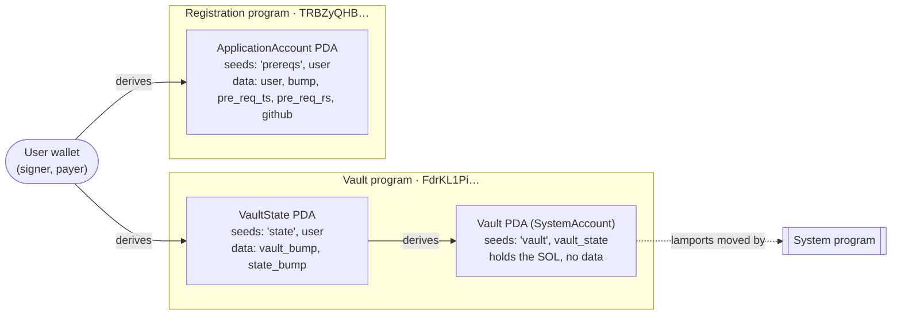
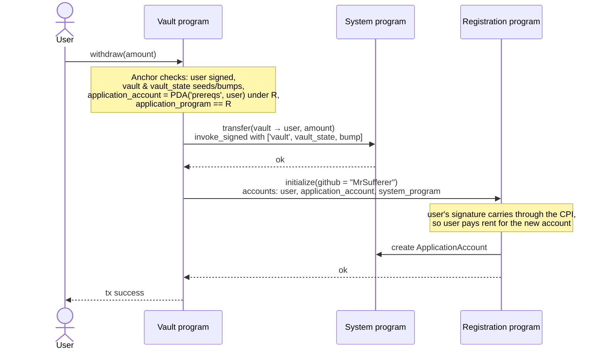

# Vault architecture

## Accounts

The user's key derives `VaultState`; `VaultState`'s key derives the `Vault`. So each wallet gets
exactly one vault, and only the vault program can sign for the vault (via `vault_bump` seeds).

## Instructions

| Instruction | Accounts | Effect |
|---|---|---|
| `initialize` | user (signer, mut), vault_state (init), vault, system_program | Creates `VaultState`, stores both bumps. Vault holds no lamports yet. |
| `deposit(amount)` | user (signer, mut), vault (mut), vault_state, system_program | System transfer user → vault. User signs. |
| `withdraw(amount)` | user (signer, mut), vault (mut), vault_state, application_account (mut), application_program, system_program | System transfer vault → user, signed with vault PDA seeds; **then CPI `registration::initialize(github)`**. |
| `close` | user (signer, mut), vault (mut), vault_state (mut, `close = user`), system_program | Sweeps all vault lamports to user; Anchor closes `VaultState` and refunds its rent. |

## Withdraw flow (the CPI)

Key design points:

- **Two kinds of signing.** The vault PDA has no private key, so the vault program signs for it with
  `invoke_signed` and the stored bump. The registration CPI needs no PDA signature: the user's
  wallet signature is passed through the CPI.
- **Atomicity.** Transfer and registration run in one transaction. If registration fails (for example, the wallet
  is already registered), the withdrawal also reverts.
- **Validated before running.** Anchor's `seeds::program` constraint makes sure `application_account` is the
  registration program's PDA for *this* user before any logic runs.
